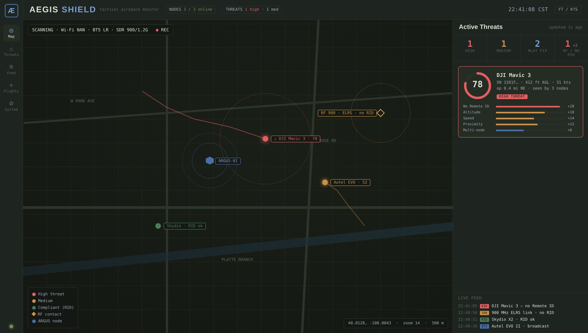

# AEGIS Platform

> **A**irspace **E**nforcement and **G**round **I**ntelligence **S**ystem  
> Multi-node Remote ID detection, threat scoring, and MLAT position estimation

```
                    ┌──────────────────────────────────────────┐
                    │          AEGIS SHIELD (UI)               │
                    │  Live map · Threat scores · MLAT circles │
                    │  Packet feed · Node health · Alert feed  │
                    └──────────────────┬───────────────────────┘
                                       │ WebSocket /ws
                    ┌──────────────────▼───────────────────────┐
                    │            AEGIS SERVER                  │
                    │  FastAPI · TimescaleDB · MQTT broker     │
                    │  Alert engine · Trilateration · Threat AI│
                    └──────┬───────────────┬───────────────┬───┘
                           │ MQTT          │ MQTT          │ MQTT
                    ┌──────▼─────┐  ┌──────▼─────┐  ┌──────▼─────┐
                    │  ARGUS-01  │  │  ARGUS-02  │  │  ARGUS-03  │
                    │  Wi-Fi NAN │  │  Wi-Fi NAN │  │  Wi-Fi NAN │
                    │  BT5 LR    │  │  BT5 LR    │  │  BT5 LR    │
                    │  RTL-SDR   │  │  GPS       │  │  RTL-SDR   │
                    │  GPS       │  │            │  │  GPS       │
                    └────────────┘  └────────────┘  └────────────┘
```

AEGIS detects FAA-mandated Remote ID broadcasts from drones across all three radio technologies (Wi-Fi NAN, Bluetooth 4 legacy, Bluetooth 5 Long Range), correlates detections from multiple sensor nodes, estimates true drone position via RSSI trilateration (MLAT), and scores each drone with an 8-factor threat model. Everything streams live to AEGIS Shield — a tactical operations dashboard with a real Leaflet map, animated threat gauges, and a live packet feed.



---

## Table of Contents

- [Quick Start](#quick-start)
- [Architecture](#architecture)
- [Hardware](#hardware)
- [Deployment](#deployment)
  - [AEGIS Server](#aegis-server-deployment)
  - [Managing the server](#managing-the-server)
  - [ARGUS Nodes](#argus-node-deployment)
  - [WireGuard VPN](#wireguard-vpn-optional)
- [Calibration](#calibration)
- [AEGIS Shield](#aegis-shield)
- [API Reference](#api-reference)
- [Threat Scoring](#threat-scoring)
- [MLAT / Trilateration](#mlat--trilateration)
- [Troubleshooting](#troubleshooting)
- [Development](#development)
- [Test Suite](#test-suite)

---

## Quick Start

```bash
# 1. Clone
git clone https://github.com/RED-RED-RED/project-aegis-shield
cd project-aegis-shield

# 2. Deploy AEGIS Server (Docker required, Ubuntu/Debian/Pi OS 64-bit)
sudo bash scripts/deploy-aegis-server.sh

# 3. Deploy each ARGUS Node (run on each Pi)
sudo bash scripts/deploy-argus-node.sh

# 4. Verify
python scripts/healthcheck.py --server <SERVER_IP>
```

Open `http://<server-ip>` — AEGIS Shield will appear.

---

## Architecture

### Components

| Component | Description | Runs on |
|---|---|---|
| **ARGUS Node** | Sensor node — scans Wi-Fi NAN, BT4/5, SDR; publishes to MQTT | Raspberry Pi 5 (8 GB) |
| **AEGIS Server** | Central platform — ingests MQTT, stores detections, runs analysis | Pi 5 / x86 mini PC / any 64-bit Linux + Docker |
| **AEGIS Shield** | Tactical dashboard — live map, threats, packet feed, flight history, system health | Browser (Nginx) |
| **Calibration** | RSSI path-loss model fitting for MLAT accuracy | Runs anywhere |

### Data flow

```
ARGUS Node                    AEGIS Server                  AEGIS Shield
──────────                    ────────────                  ────────────
WiFi NAN scan  ─── MQTT ───►  subscriber.py                useStore.js
BT5 LR scan    ─── MQTT ───►    │── INSERT detections       │── /ws WebSocket
GPS fix        ─── MQTT ───►    │── UPSERT drone_tracks     │── /api/analysis
heartbeat      ─── MQTT ───►    │── alert_engine.evaluate   │
                                │── pipeline.process        MapView.jsx
                                │     ├── trilateration     ThreatPanel.jsx
                                │     └── threat_scoring    RightPanel.jsx
                                └── ws_broadcaster.broadcast
```

### MQTT topic schema

| Topic | Direction | Content |
|---|---|---|
| `argus/<id>/detection` | node → server | Full RID frame, RSSI, node GPS |
| `argus/<id>/heartbeat` | node → server | CPU, memory, GPS fix, active radios list, jamming/spoofing state, survey status (10s) |
| `argus/<id>/status` | node → server | `online`/`offline` (LWT, retained) |
| `argus/<id>/rf_detection` | node → server | SDR-classified RF control/video link — OcuSync, ELRS, FPV video, etc. (optional) |

**Heartbeat extra fields (NEO-M9N only):**

| Field | Values | Description |
|---|---|---|
| `jamming_state` | `ok` / `warning` / `critical` | Hardware GPS jamming indicator from UBX-NAV-STATUS |
| `spoofing_state` | `ok` / `spoofing` / `multiple` | Hardware GPS spoofing indicator from UBX-NAV-STATUS |
| `survey_complete` | `true` / `false` | Whether the node has completed survey-in |
| `detected_port` | e.g. `/dev/ttyACM0` | Serial port the GPS daemon auto-detected |
| `gps_mode` | `usb` / `uart` | Active GPS mode |

---

## Hardware

### Per ARGUS Node (~$550–650 as configured)

Reference build for the current field node. Prices are rough street figures and will drift — treat them as ballpark, not a quote.

| Part | Example | Role | ~Cost |
|---|---|---|---|
| Single-board computer | Raspberry Pi 5 Model B (8 GB) | Host | $80 |
| Active cooler | GeeekPi Armor Lite V5 | Thermal | $12 |
| Boot storage | microSD (A2) or NVMe + HAT | OS + local cache | $15–40 |
| UPS | Geekworm X1202 (5 V out, 6–18 V in) | Ride-through power + clean shutdown | $55 |
| Wi-Fi adapter | Alfa AWUS036ACM | Wi-Fi NAN monitor mode (mt76x2u) | $60 |
| Bluetooth dongle | Nordic nRF52840 Dongle (PCA10059) | BT4 + BT5 Long Range (Coded PHY) | $11 |
| GPS module | u-blox NEO-M9N (USB) | Geolocation + jamming/spoofing detection | $77 |
| Active GPS antenna | SMA active patch/puck (external) | GPS reception — quality matters a lot (see note) | ~$30 |
| SDR | RTL-SDR Blog V4 (HackRF for 2.4/5.8 GHz) | RF link detection | $40 (HackRF $300+) |
| Wi-Fi antennas | Dual-band 6 dBi N-male omni ×2 (e.g. MikroTik Groove spares) | External Wi-Fi | $0 on hand (~$26 new) |
| Enclosure | Weatherproof outdoor hotspot kit (RAK/MNTD style) | IP-rated housing | $60 |
| RF cabling & adapters | RG316 SMA/N pigtails, bulkhead panel mounts, SMA/RP-SMA adapter kit | Panel-mount RF interconnect | ~$42 |
| USB cabling | USB-A 3.0, USB-C 3.1 Gen2, USB-A extension (1 ft) | Peripheral interconnect | ~$24 |
| Panel hardware | Waterproof momentary power button, IP68 breather vent, status LED | Enclosure I/O | ~$25 |

Roughly **$550–600** per node with the RTL-SDR. Swapping in a HackRF (for 2.4/5.8 GHz coverage) adds ~$300+. Several items (GPS module, Wi-Fi antennas, storage) you may already have on hand.

**Enclosure fit** — space is tight. Fitting a HackRF alongside the Alfa, GPS and nRF52840 likely means shorter USB cables and adding a compact **powered USB hub** (~$15–25) to supply the Alfa + HackRF current draw without browning out the Pi. Budget room (and amps) for it.

**Test equipment (not part of a node)** — a cooperative Remote ID broadcaster such as the **Ruko R111S** (~$40) is useful for validating detection end-to-end: fly or bench it and confirm the node picks it up on the map.

### AEGIS Server (~$150–250)

Any 64-bit Linux machine with Docker. The stack (TimescaleDB + Mosquitto + FastAPI + Nginx) is light on CPU but benefits from an **NVMe SSD** — TimescaleDB is write-heavy, so don't run the database on an SD card — and **16 GB RAM** for the history views. A fanless Intel N100/N305 mini PC (16 GB / NVMe, ~$150–250, 12–19 V input for vehicle/field use) is the sweet spot; a Raspberry Pi 5 (8 GB) with an NVMe HAT also works for small deployments. An old NUC or a cloud VPS works equally well.

### Critical hardware notes

**Alfa AWUS036ACM** — the `mt76x2u` driver is the only reliable option for capturing Wi-Fi NAN action frames in monitor mode. Most other adapters filter them out at the driver level.

**nRF52840 USB dongle** — must be flashed with [Zephyr `hci_usb` firmware](https://docs.zephyrproject.org/latest/samples/bluetooth/hci_usb/README.html) to appear as a standard HCI USB device. Most cheap "BT5" dongles advertise Coded PHY support but do not implement it in firmware — the nRF52840 is the reliable exception.

**u-blox NEO-M9N (USB, recommended)** — plug into any Pi USB port. The driver creates `/dev/ttyACM0`; the deploy script adds a udev rule so it also appears at the stable symlink `/dev/ttyGPS`. No UART configuration or serial console changes are needed. The GPS daemon auto-detects the port at startup, initialises the receiver via UBX binary protocol, and runs a **survey-in** (10 min minimum / 3 m accuracy target) to pin the node's precise position. Once the survey completes, `survey_complete` is set in the nodes table and that node receives a **3× weight multiplier** in the WLS trilateration solver. The NEO-M9N also reports hardware **jamming** and **spoofing** state via `UBX-NAV-STATUS`; critical/warning states trigger a `gps_jamming` alert on the server.

**u-blox NEO-M8N (UART, legacy)** — connect to Pi UART (`/dev/ttyAMA0`). Pass `--gps-mode uart` to the deploy script; it enables the UART in `/boot/firmware/config.txt` and disables the serial console. **A reboot is required** after this setup. The NEO-M8N does not support UBX survey-in or hardware jamming/spoofing detection.

**SDR frequency coverage** — the RTL-SDR Blog V4 reaches ~1.766 GHz, so on an RTL-SDR the scanner covers **433 / 900 MHz and 1.2 GHz** only; 2.4 and 5.8 GHz are above the tuner and are skipped automatically. A **HackRF** (1 MHz – 6 GHz) is supported for full coverage, including 2.4 GHz OcuSync/ELRS and 5.8 GHz FPV video — set `sdr_backend: hackrf` in the node config and install SoapySDR. The classifier is **receive-only**; the HackRF's transmit path is never used (jamming is illegal for non-federal operators). Classifier thresholds are first-order and meant to be field-calibrated against a known transmitter (e.g. a RadioMaster ELRS radio).

---

## Deployment

### AEGIS Server deployment

```bash
# Interactive
sudo bash scripts/deploy-aegis-server.sh

# Non-interactive (Ansible, cloud-init, CI)
AEGIS_DB_PASSWORD=yourdbpass \
AEGIS_MQTT_PASSWORD=yourmqttpass \
sudo bash scripts/deploy-aegis-server.sh --yes
```

The script: installs Docker, builds AEGIS Shield, generates credentials, configures Mosquitto auth, starts all containers via Docker Compose, and installs an `aegis-server.service` systemd unit for auto-start on boot.

**Running services after deployment:**

| Service | Port | Description |
|---|---|---|
| Nginx | 80 | AEGIS Shield UI + API reverse proxy |
| AEGIS Server (FastAPI) | 8000 | Internal, proxied by Nginx |
| Mosquitto | 1883 | MQTT broker (authenticated) |
| TimescaleDB | 5432 | Internal only |

Credentials are written to `aegis-server/docker/.env` — back this file up.

### Managing the server

```bash
make server-up       # Start all containers
make server-down     # Stop all containers (data volumes are preserved)
make server-rebuild  # Rebuild and restart the aegis-server container (use after code changes)
make server-logs     # Follow live logs from the FastAPI container
make server-status   # Show container status
```

The four containers that start together:

| Container | Port | Description |
|---|---|---|
| `nginx` | 80 | Serves AEGIS Shield UI and proxies `/api` and `/ws` |
| `aegis-server` | 8000 (internal) | FastAPI — starts after timescaledb and mosquitto are healthy |
| `mosquitto` | 1883 | MQTT broker (authenticated) |
| `timescaledb` | 5432 (internal) | Time-series database |

### API authentication

All `/api/*` endpoints and the WebSocket are protected by an optional API key. Authentication is **disabled by default** (safe for trusted LAN deployments). To enable it, set `AEGIS_API_KEY` in `aegis-server/docker/.env`:

```env
AEGIS_API_KEY=your-secret-key-here
```

Once set, every request must include the key as a header:

```
X-Api-Key: your-secret-key-here
```

The `/health` endpoint is always unauthenticated. It returns server CPU/memory/disk usage, database connectivity status, MQTT reachability (based on last node heartbeat), and online/total node counts — used by the AEGIS Shield Server Health panel.

### Notifications (Pushover)

Push alerts to your phone with [Pushover](https://pushover.net/). **Disabled by default.** Create a Pushover **application** for the API token, grab your **user key** (or a delivery-group key for a team), and set both in `aegis-server/docker/.env`:

```env
PUSHOVER_ENABLED=true
PUSHOVER_TOKEN=your-pushover-app-token
PUSHOVER_USER=your-user-or-group-key
```

Behaviour (all configurable — see `.env.example`):

- **HIGH** alerts push at priority 1 (loud, bypasses the phone's quiet hours); **MEDIUM** at priority 0. `PUSHOVER_MIN_LEVEL` sets the floor (default `medium`); LOW alerts like `new_drone` never push.
- Categories in `PUSHOVER_EMERGENCY_CATEGORIES` (e.g. `spoofed_position,gps_jamming`) go **Emergency** (priority 2 — repeats until acknowledged on the phone) and bypass the level floor.
- A **per-drone cooldown** (default 10 min) stops a loitering contact from buzzing every cycle; an escalation to a higher level breaks through it. A **max-per-hour** cap guards against floods.
- **Critical node health** pushes separately: a node going offline, or CPU temp / disk crossing `PUSHOVER_TEMP_CRIT_C` / `PUSHOVER_DISK_CRIT_PCT` (warnings don't push — critical only).

After enabling and redeploying, verify with `POST /api/notify/test` (fires a sample push). Sends are fire-and-forget and never block or crash the alert pipeline.

If you are running AEGIS Shield from the same origin (via Nginx reverse proxy), add the key to the Shield's build environment so it is included in API calls:

```env
# aegis-shield/.env.production
VITE_API_KEY=your-secret-key-here
```

> **Recommendation:** Enable API key auth whenever AEGIS Server is reachable from outside your local network, such as over WireGuard VPN or a public interface.

### ARGUS Node deployment

Flash Pi OS Lite 64-bit to SD card, enable SSH, then:

```bash
# Copy project to node
scp -r aegis-platform/ pi@argus-01.local:~/
ssh pi@argus-01.local

# Interactive install — prompts for all values
sudo bash aegis-platform/scripts/deploy-argus-node.sh

# Non-interactive install (USB GPS, default)
sudo bash aegis-platform/scripts/deploy-argus-node.sh \
  --unattended \
  --node-id ARGUS-01 \
  --server-ip 192.168.1.100 \
  --mqtt-password yourmqttpass

# Non-interactive install (legacy UART GPS — requires reboot)
sudo bash aegis-platform/scripts/deploy-argus-node.sh \
  --unattended \
  --node-id ARGUS-01 \
  --server-ip 192.168.1.100 \
  --mqtt-password yourmqttpass \
  --gps-mode uart
sudo reboot   # only required for uart mode

# After (re)boot
sudo systemctl status argus-node
sudo journalctl -fu argus-node
```

Or run interactively — the script prompts for all values, including GPS mode, and explains each option.

**GPS mode flag:**

| Flag | Default | Description |
|---|---|---|
| `--gps-mode usb` | yes | u-blox NEO-M9N via USB (`/dev/ttyACM0` → `/dev/ttyGPS`) |
| `--gps-mode uart` | no | Legacy NEO-M8N via UART (`/dev/ttyAMA0`); enables UART in boot config, reboot required |

**Deploying multiple nodes:**

```bash
# Node 1 (USB GPS)
sudo bash scripts/deploy-argus-node.sh \
  --unattended --node-id ARGUS-01 --server-ip 192.168.1.100 --mqtt-password pass

# Node 2
sudo bash scripts/deploy-argus-node.sh \
  --unattended --node-id ARGUS-02 --server-ip 192.168.1.100 --mqtt-password pass
```

### WireGuard VPN (optional)

Required when ARGUS nodes are deployed outside your LAN:

```bash
# On AEGIS server first
sudo bash scripts/setup-wireguard.sh server

# On each ARGUS node (prompts for server public key)
sudo bash scripts/setup-wireguard.sh node <SERVER_PUBLIC_IP> <NODE_INDEX>
```

Or pass `ARGUS_USE_VPN=1` to `deploy-argus-node.sh` and it handles VPN setup automatically.

VPN addressing: AEGIS server = `10.100.0.1`, nodes = `10.100.0.2`, `.3`, `.4`…

### Health check

```bash
python scripts/healthcheck.py --server 192.168.1.100
```

Verifies TCP connectivity to all services, checks the REST API, reports node online/offline status, and flags any open HIGH alerts.

### Updating

After pushing new code, update each machine from its own checkout.

**Server** (run from the repo root on the server host):

```bash
sudo bash scripts/update.sh server   # Pull latest, rebuild UI, rebuild + restart the API container
# or: make update
```

This runs a fast-forward `git pull`, rebuilds the dashboard (`aegis-shield/dist`, which nginx serves live from a read-only volume, so no nginx restart is needed), then rebuilds and restarts the `aegis-server` container. New database tables are created automatically on startup (`CREATE TABLE IF NOT EXISTS`), so there is no separate migration step. Add `--skip-ui` to leave the dashboard untouched, or `--no-pull` to rebuild the current checkout without fetching.

**Node** (run on each Raspberry Pi, repo at `/opt/argus-node`):

```bash
sudo bash scripts/update.sh node     # Pull latest, update venv deps, re-patch pyrtlsdr, restart the service
# or: make update-node
```

This does `git fetch` + `git reset --hard origin/main`, reinstalls `argus-node/requirements.txt` into the venv, re-applies the Python 3.13 pyrtlsdr patch, and restarts `argus-node.service`.

**Version check** (any host):

```bash
bash scripts/update.sh version       # Show current commit, branch, date, and API version
# or: make version
```

---

## Calibration

The MLAT trilateration engine uses a log-distance path-loss model with default parameters (`RSSI_REF = −20 dBm`, `n = 2.7`). These should be calibrated for your specific site and hardware to improve position accuracy and lower the spoof-detection false-positive rate.

```bash
# Fly a cooperative drone for 5–10 min, export GPX from controller app
python calibration/calibrate.py \
  --server http://192.168.1.100:8000 \
  --drone-id YOUR_DRONE_SERIAL \
  --gpx my_flight.gpx \
  --notes "Open field, 3 ARGUS nodes" \
  --plots

# Outputs:
#   aegis-server/analysis/calibration.yaml  (per-node fitted parameters)
#   calibration/cal_report.txt              (human-readable report)
#   calibration/cal_plots/                  (diagnostic plots, if matplotlib installed)

# Restart server to load calibration
cd aegis-server/docker && docker compose restart aegis-server
```

Supports GPX (DJI Fly, Litchi, Mission Planner), DJI SRT subtitle files, and CSV tracks. Each ARGUS node gets independent fitted parameters. See [`calibration/`](calibration/) for full documentation.

---

## AEGIS Shield

AEGIS Shield connects to the AEGIS Server via WebSocket (`/ws`) and receives a full state snapshot every 500ms. Threat data is polled from the REST API every 3 seconds. Units default to **imperial** (toggle in the top-right corner).

### Views

| View | Description |
|---|---|
| **Live Map** | Leaflet map with threat-coloured drone markers, RF-contact diamonds, MLAT circles, confidence radii, mismatch lines, node pulse rings, and track trails. Contacts seen in the last ~2 min show solid; older ones dim and drop off the live map after 15 min; a dismiss control hides one immediately. |
| **Threats** | Full-width panel with animated 0–100 score gauges, 8-factor breakdown bars, MLAT position detail, spoof confidence meter, and an "RF / No RID" strip. Live drones show solid; stale ones (>2 min) are dimmed. |
| **Packet Feed** | Detection stream pre-seeded with the last 150 detections on load, then live via WebSocket. Includes SDR-classified RF links with RID / no-RID tags. |
| **Flights** | Historical sorties — detections grouped into flights (new flight after a >5 min gap). Filterable flight list; the selected flight shows its path, operator location, detecting nodes, altitude/speed profile, a time-scrub replay, and GPX/KML/CSV export. No-RID / RF-only contacts are listed separately. |
| **System** | Live status cards for every node and the server (CPU/mem/disk, temp, uptime, GPS sats, DB/MQTT) plus historical charts (1h–7d range, ~7-day retention) with warning bands. |

### Sidebar

- **ARGUS Nodes** — lists each node with status dot, CPU %, GPS fix, and active radio badges (WiFi / BT5 / SDR). Badges reflect the actual scanners running on the node.
- **Node Health** — CPU/MEM/DISK mini-bars and temperature (imperial or metric) for the selected node.
- **Server Health** — CPU/MEM/DISK bars and DB/MQTT status dots for the AEGIS Server, polled every 10 seconds from `/health`.

### Active Alerts

Alerts can be dismissed individually (× button, visible on hover) or all at once with **Dismiss All**. Dismissal calls `POST /api/alerts/{id}/acknowledge` and removes the alert from the feed immediately.

### Map overlays

- **Drone marker** — colour-coded by threat score: green (low) / amber (medium) / red (high, pulsing). Numeric score label above each dot.
- **MLAT marker** — dashed circle at RSSI-estimated position, colour encodes spoof confidence
- **Confidence circle** — `L.circle` radius = MLAT uncertainty in metres
- **Mismatch line** — dashed line from broadcast position to MLAT estimate (drawn when > 100m divergence, red above 500m)
- **Node hexagon** — steel-blue hex with expanding CSS pulse rings when online
- **Track trail** — 60-point rolling history polyline, inherits threat colour
- **RF contact** — amber diamond at the detecting node with a dashed ring (RSSI range estimate, **not** a position fix). Red + ⚠ only when escalated to medium/high; muted when it's uncorroborated ISM (e.g. a lone 900 MHz meter); green when it correlates to a Remote ID broadcast
- **Stale fade** — any contact not seen within ~2 min dims; it is removed from the live map after 15 min (still available in the Flights view)

### Building from source

```bash
cd aegis-shield
npm install
npm run dev     # Dev server :5173, proxies /api and /ws to :8000
npm run build   # Production → dist/ (served by Nginx container)
```

---

## API Reference

Base URL: `http://<server>/api/` (via Nginx) or `http://<server>:8000/api/` (direct)

### Detections & tracking

```
GET  /api/detections                    Detection log (filter: node_id, drone_id, transport, start, end)
GET  /api/detections/tracks             Active drone tracks — one row per drone
GET  /api/detections/tracks/{id}        Single drone track
GET  /api/detections/tracks/{id}/history Time-series position history
GET  /api/detections/stats              Aggregate counts
```

### Nodes

```
GET  /api/nodes                         All ARGUS nodes with health
GET  /api/nodes/{id}                    Node detail
GET  /api/nodes/{id}/detections         Recent detections from one node
```

### Alerts

```
GET  /api/alerts                        Alert list (filter: level, category, acknowledged)
POST /api/alerts/{id}/acknowledge       Acknowledge single alert
POST /api/alerts/acknowledge-all        Acknowledge all open alerts
GET  /api/alerts/stats                  Counts by level
```

### Analysis

```
GET  /api/analysis/threats              Scored drones, sorted by threat_score DESC
GET  /api/analysis/threats/{id}         Full threat detail for one drone
GET  /api/analysis/mlat                 Drones with MLAT results (filter: min_mismatch_m)
GET  /api/analysis/stats                High/medium counts, spoofed count, average score
```

### RF (SDR)

```
GET  /api/rf/contacts                   SDR-classified RF links (filter: active_only, dark_only, limit)
GET  /api/rf/stats                      RF contact counts
```

### System health

```
GET  /api/system/health/history         Per-node + server cpu/mem/disk/temp series (range: 1h|6h|24h|7d)
```

### Flights

```
GET  /api/flights                       Flight list (filter: range, compliant, node, min_threat)
GET  /api/flights/{id}                  Flight detail — path, operator, detecting nodes, profile
GET  /api/flights/{id}/export?format=   gpx | kml | csv download
GET  /api/flights/rf-contacts           No-RID / RF-only contacts over a range
```

### Notifications

```
GET  /api/notify/status                 Pushover config state (no secrets)
POST /api/notify/test                   Fire a sample push to verify setup
```

### Alert categories

| Category | Level | Trigger |
|---|---|---|
| `no_rid` | HIGH | Drone airborne above threshold altitude with no operator ID |
| `speed` | MEDIUM | Horizontal speed exceeds configured threshold (default 30 m/s) |
| `altitude` | MEDIUM | Above 400ft AGL without operator ID |
| `spoofed_position` | HIGH | Drone reporting position at (0, 0) while airborne |
| `new_drone` | LOW | First detection of a drone ID in the database |
| `threat_score` | HIGH | Threat score crosses into ≥ 70 band |
| `position_mismatch` | HIGH | MLAT estimate diverges > 250m from broadcast with spoof confidence > 60% |
| `gps_jamming` | MEDIUM | ARGUS node reports GPS jamming (`warning` or `critical`) from UBX-NAV-STATUS |
| `rf_no_rid` | HIGH / MEDIUM | SDR-classified drone link (2.4 / 5.8 GHz) with no correlating Remote ID broadcast. 900/433 MHz links need corroboration (a second node) before they alert |

### WebSocket

`WS /ws` — Server pushes:

| Message type | Trigger | Content |
|---|---|---|
| `live_state` | Every 500ms | Full snapshot: drones, nodes, alerts, RF contacts, detection rate |
| `detection` | Per detection | Single detection for packet feed |
| `rf_detection` | Per RF link | SDR-classified RF contact for the packet feed / map |
| `alert` | Per alert | New alert object |
| `node_update` | Per heartbeat | Node status + health metrics |

---

## Threat Scoring

Each active drone receives a score from 0–100:

| Factor | Weight | Triggers |
|---|---|---|
| No operator ID | **30** | Missing or suspiciously short operator ID |
| Position mismatch | **25** | MLAT estimate diverges from broadcast (sigmoid at 250m) |
| High altitude / no RID | **15** | Above 400ft AGL without operator ID |
| Unknown UA type | **8** | Type field absent, "none", or "ground_obstacle" while airborne |
| Speed anomaly | **8** | > 25 m/s (ramps) / > 50 m/s (max, physically implausible) |
| Single node only | **7** | Only one ARGUS node detecting the drone |
| Stale GPS | **4** | `last_seen` timestamp drifting behind wall clock |
| No self-ID | **3** | Missing description string |

**≥ 70 → HIGH** · **40–69 → MEDIUM** · **< 40 → LOW**

---

## MLAT / Trilateration

AEGIS uses weighted least-squares trilateration on RSSI measurements from ≥ 3 ARGUS nodes to independently estimate each drone's position. Compared to the drone's broadcast position to detect GPS spoofing.

**Model:** `RSSI = RSSI_REF − 10 × n × log₁₀(d)`

**Accuracy:**

| Conditions | Typical RMSE |
|---|---|
| Ideal (noiseless, open field, 4 nodes) | 50–80m |
| Real-world (5 dB noise, suburban) | 150–250m |
| Post-calibration improvement | ~40% reduction |

**Survey-in weight multiplier:** Nodes that have completed a GPS survey-in (`survey_complete = true`) receive a **3× weight** in the WLS solver. This reflects that their position is precisely known (sub-3m accuracy) rather than estimated from a live GPS fix. Deploy nodes with NEO-M9N receivers and allow the 10-minute survey-in to complete for best MLAT accuracy.

The calibration utility fits `n` and `RSSI_REF` independently per node from a calibration flight, then writes `aegis-server/analysis/calibration.yaml` which the trilateration engine loads at startup.

---

## Troubleshooting

### SDR scanner exits immediately (`SDR libraries not available`)

`pyrtlsdr` depends on `pkg_resources` which is not included in the default Python 3.13 venv. Fix:

```bash
sudo /opt/argus-node/venv/bin/pip install 'setuptools==69.5.1' --force-reinstall --no-binary :all:
sudo systemctl restart argus-node
```

### `setup_interfaces.sh: Permission denied` after git pull

`git reset --hard` strips the execute bit from `setup_interfaces.sh`. Fix:

```bash
sudo chmod +x /opt/argus-node/argus-node/systemd/setup_interfaces.sh
sudo systemctl restart argus-node
```

To prevent recurrence, the execute bit is tracked in git (`git update-index --chmod=+x`). If it reappears, re-run the `git update-index` command on the dev machine and push.

### SDR segfaults / `[R82XX] PLL not locked`

The R820T tuner cannot tune above ~1,766 MHz. If you have modified `SWEEP_FREQS` in `sdr.py` to include 2.4 GHz frequencies, the device will segfault. Keep all frequencies below `R820T_MAX_HZ = 1_766_000_000`.

---

## Development

```bash
# Run all 311 tests
make test

# Individual suites
make test-node     # 200 tests — RID parser, GPS, Wi-Fi NAN, Bluetooth HCI, SDR classifier (scapy required for Wi-Fi NAN)
make test-server   # 80 tests  — alert engine, trilateration, threat scoring, RF pipeline, system + flights
make test-cal      # 31 tests  — calibration engine, collector, config writer

# Start server
make server-up && make server-logs

# UI dev (hot reload)
make ui-dev
```

See [CONTRIBUTING.md](CONTRIBUTING.md) for conventions and workflow.

---

## Test Suite

| Module | Tests |
|---|---|
| ARGUS Node — OpenDroneID parser + RID wire formats | 30 |
| ARGUS Node — GPS subsystem (auto-detect, UBX, survey-in, jamming) | 66 |
| ARGUS Node — Wi-Fi NAN dual-adapter scanner (requires scapy) | 31 |
| ARGUS Node — Bluetooth HCI (BT4/5 Long Range) | 43 |
| ARGUS Node — SDR classifier + scanner | 30 |
| AEGIS Server — alert engine (rules + GPS jamming alerts) | 19 |
| AEGIS Server — trilateration + threat scoring | 30 |
| AEGIS Server — RF pipeline (classify → correlate → score → alert) | 22 |
| AEGIS Server — system health + flight history | 9 |
| Calibration — engine, collector, config writer | 31 |
| **Total** | **311** |

---

## License

MIT — see [LICENSE](LICENSE)

## Acknowledgements

- [OpenDroneID](https://github.com/opendroneid/opendroneid-core-c) — ASTM F3411 reference implementation
- [FAA Remote ID](https://www.faa.gov/uas/getting_started/remote_id) — regulatory framework
- [Leaflet.js](https://leafletjs.com/) — mapping
- [TimescaleDB](https://www.timescale.com/) — time-series storage
- [FastAPI](https://fastapi.tiangolo.com/) — API framework
